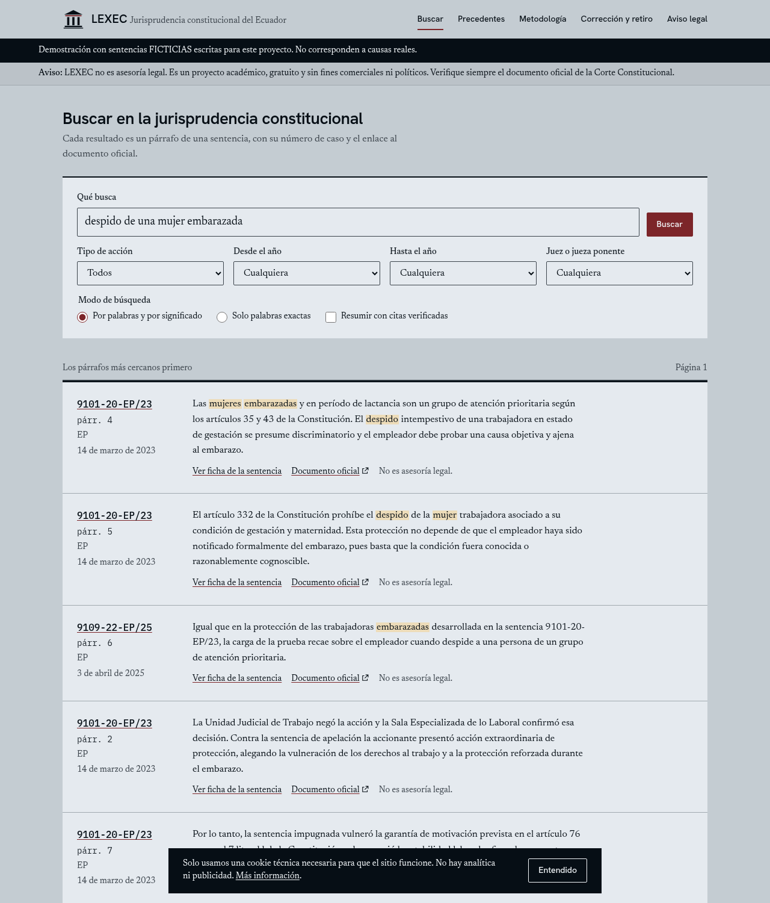
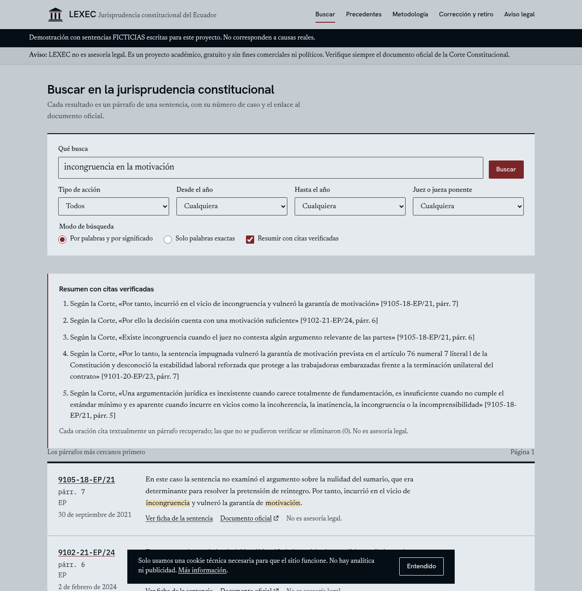
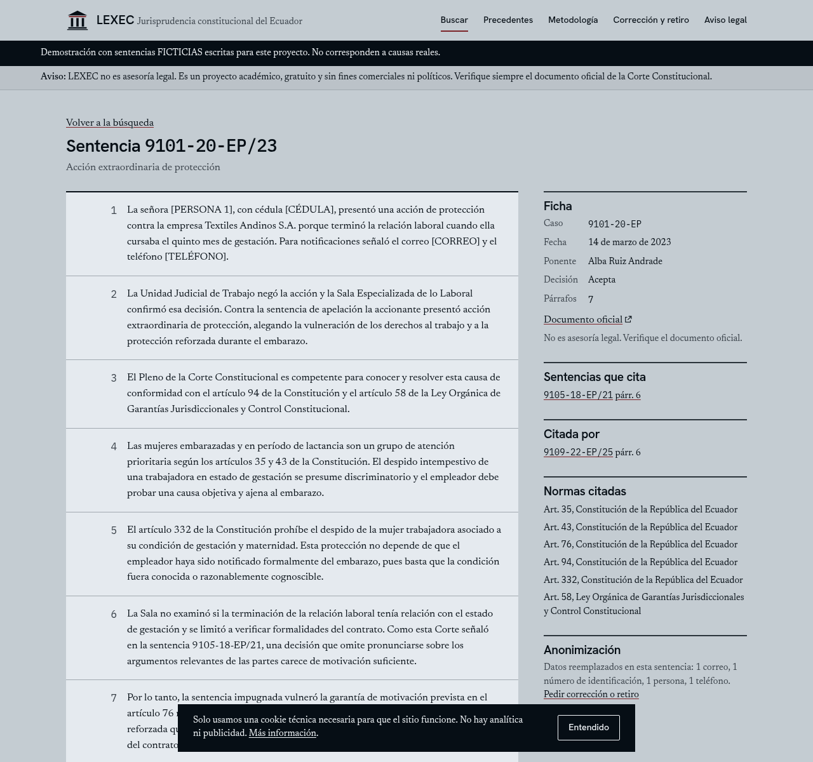
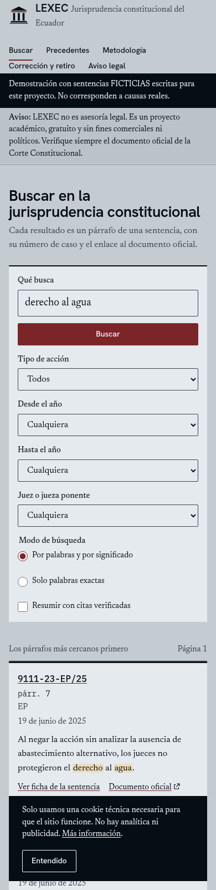
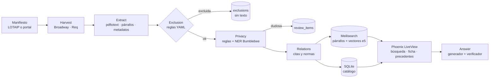
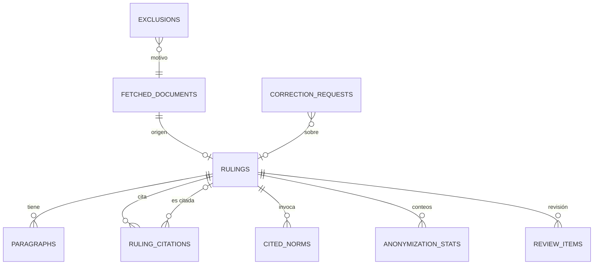

# LEXEC

Buscador de jurisprudencia de la Corte Constitucional del Ecuador que responde siempre con el párrafo exacto, su número de caso y el enlace al documento oficial.


   

**Demo:** local con Docker Compose (ver [Despliegue](#despliegue)) · **Usuario de prueba:** no hay cuentas; el área de revisión usa las credenciales de tu `.env`.

> LEXEC no es asesoría legal. La demo usa **sentencias ficticias** escritas para este proyecto: ninguna persona, cédula ni número de caso es real.



| Resumen con citas verificadas | Ficha de sentencia | Móvil |
|---|---|---|
|  |  |  |

## Problema que resuelve

Las sentencias de la Corte Constitucional son públicas, pero están en PDF sueltos, difíciles de buscar por tema y casi imposibles de recorrer para saber qué ha dicho la Corte sobre un derecho. Estudiantes de Derecho, abogados que empiezan, periodistas y ciudadanos que presentan una acción de protección necesitan encontrar rápido **qué dijo la Corte, en qué párrafo y en qué caso**, sin inventos y sin exponer a las personas involucradas.

## Funcionalidades

- **Búsqueda híbrida por párrafo:** palabras exactas y significado a la vez (Meilisearch + embeddings locales `multilingual-e5-small`), con filtros por tipo de acción, año y juez/a ponente. Todo el estado vive en la URL y funciona sin JavaScript.
- **Resultado citable:** cada párrafo muestra número de caso, número de párrafo, fecha, tipo de acción, aviso "no es asesoría legal" y enlace al documento oficial.
- **Resumen con citas (opcional):** cada oración debe citar textualmente un párrafo recuperado; un verificador elimina el resto. Si nada pasa: "No encontré sentencias que respondan esto".
- **Red de precedentes:** sentencias más citadas, artículos más invocados por tipo de acción y grafo de citas.
- **Privacidad por diseño:** exclusión de causas con niñez y violencia **antes** de cualquier modelo, anonimización por reglas + NER, cola de revisión humana, canal público de corrección y retiro.
- **Recopilación respetuosa:** Broadway con 1 petición/s, robots.txt (RFC 9309), caché por URL y SHA-256, reintentos con espera exponencial y tolerancia a fallos.

## Arquitectura



Código por responsabilidad: `lib/lexec/{harvest,extract,privacy,relations,index,answer}`, catálogo en `lib/lexec/catalog*`, interfaz en `lib/lexec_web`, reglas versionadas en `priv/rules/*.yaml`.

## Stack y por qué

| Capa | Tecnología | Motivo |
|---|---|---|
| Lenguaje | Elixir 1.20.5 / OTP 29.1.2 | Concurrencia y supervisión: un PDF roto no detiene el pipeline; tipado gradual verificado al compilar |
| Pipeline | Broadway 1.3 + Req 0.7 | Etapas con control de presión y límite de ritmo nativo; HTTP con stubs para pruebas |
| Modelos | Bumblebee 0.8 + Nx/EXLA 1.0 | NER y embeddings de Hugging Face dentro de la BEAM, sin Python ni servicios externos |
| Búsqueda | Meilisearch 1.56.2 Community (MIT) | Búsqueda híbrida con `semanticRatio` y embedder `userProvided` |
| Catálogo | Ecto 3.14 + SQLite (`ecto_sqlite3`) | Un archivo, cero administración, migraciones versionadas |
| Interfaz | Phoenix 1.8 + LiveView 1.2 | Tiempo real sin escribir JavaScript; render en servidor accesible y sin dependencias de terceros |
| Extracción | poppler `pdftotext` | Orden de lectura correcto, sin servicios externos |
| Calidad | ExUnit, StreamData, Credo `--strict`, `--warnings-as-errors` | Pruebas por propiedades y verificador de tipos de Elixir 1.20 |

## Modelo de datos



Detalle de campos, restricciones y fuentes en [docs/modelo-datos.md](docs/modelo-datos.md), derivado de [docs/investigacion.md](docs/investigacion.md).

## Ejecutar en local

### Con Docker (recomendado)

```bash
cp .env.example .env        # completa los valores (openssl rand -base64 48)
docker compose up --build   # http://localhost:4000
```

El primer arranque descarga el modelo e5 fijado (~470 MB) a un volumen y carga las sentencias ficticias por el pipeline real.

### Sin Docker

Requiere Elixir 1.20.5, OTP 29, `build-essential` y `poppler-utils`.

```bash
mix setup                   # dependencias, base de datos, demo y assets
mix phx.server              # búsqueda por palabras con el índice SQL
```

Para búsqueda híbrida, levanta Meilisearch v1.56.2 y exporta `MEILI_URL`, `MEILI_API_KEY` y `EMBEDDINGS_BACKEND=bumblebee`.

### Tareas útiles

| Comando | Qué hace |
|---|---|
| `mix lexec.ingest_text --dir priv/seeds/corpus` | Ingiere textos ya extraídos (por ejemplo, el corpus de una respuesta LOTAIP) |
| `mix lexec.harvest --manifest manifiesto.json` | Recopila PDF respetando robots.txt y 1 req/s (requiere `HARVEST_USER_AGENT` y `HARVEST_CONTACT`) |
| `mix lexec.reindex` | Reconstruye el índice desde el catálogo |
| `mix lexec.eval_search` | Compara búsqueda por palabras vs. híbrida en 50 consultas |
| `mix lexec.ner_eval` | Mide la anonimización sobre 30 párrafos sintéticos |

## Variables de entorno

| Variable | Descripción | Obligatoria |
|---|---|---|
| `SECRET_KEY_BASE` | Firma de la sesión (≥ 64 bytes) | Sí (prod) |
| `PHX_HOST`, `PHX_SCHEME`, `PHX_PUBLIC_PORT` | URL pública y orígenes permitidos del websocket | Sí (prod) |
| `DATABASE_PATH` | Ruta del archivo SQLite | Sí (prod; en Docker ya definida) |
| `ADMIN_USER`, `ADMIN_PASSWORD` | Acceso a `/admin/revision` (contraseña ≥ 16 caracteres) | Sí (prod) |
| `MEILI_URL`, `MEILI_API_KEY` | Servidor y clave de Meilisearch; sin ellas se usa el índice SQL | No |
| `MEILI_MASTER_KEY` | Clave maestra del contenedor de Meilisearch | Sí (Compose) |
| `EMBEDDINGS_BACKEND` | `bumblebee` o `none` | No (`none`) |
| `NER_BACKEND` | `rules` o `bumblebee` | No (`rules`) |
| `ANSWER_BACKEND`, `OLLAMA_URL`, `OLLAMA_MODEL` | Generador del resumen: `extractive` u `ollama` local | No |
| `HARVEST_USER_AGENT`, `HARVEST_CONTACT` | Identificación al recopilar del portal | Solo para recopilar |
| `DEMO_MODE`, `SEED_DEMO` | Aviso de datos ficticios y carga de la demo | No |

## API

LEXEC no expone una API REST: la interfaz es LiveView y su estado vive en la URL, así que cada búsqueda es un enlace compartible. Rutas en [docs/rutas.http](docs/rutas.http).

| Método | Ruta | Descripción |
|---|---|---|
| GET | `/?q=&tipo=&desde=&hasta=&ponente=&modo=&respuesta=&pagina=` | Búsqueda por párrafo |
| GET | `/sentencias/:id` | Ficha con párrafos, citas en ambos sentidos y normas |
| GET | `/precedentes?tipo=` | Más citadas, artículos más invocados, grafo |
| GET | `/correccion` | Solicitud de corrección o retiro |
| GET | `/metodologia`, `/aviso-legal` | Metodología, aviso legal, privacidad y cookies |
| GET | `/admin/revision` | Cola de revisión (HTTP Basic) |
| GET | `/health` | Estado para Docker |

## Tests y cobertura

```bash
mix test --cover                                        # 110 pruebas sin servicios externos (umbral de cobertura 70 %)
MEILI_URL=... MEILI_API_KEY=... mix test --cover --include meilisearch   # 116 pruebas, cobertura 90,8 %
LEXEC_MODELS=1 MEILI_URL=... mix test --include meilisearch --include models   # T-08 con el modelo real
```

| Código | Qué verifica | Resultado |
|---|---|---|
| T-01 | Ninguna causa excluida llega a NER, embeddings, índice ni generador | Dobles que registran todo lo que reciben |
| T-02 | Cero cédulas/teléfonos/correos; recall de personas ≥ 0,90 | 0 filtrados; reglas 31/33, reglas + NER 33/33 |
| T-03 | Instituciones y autoridades en ejercicio se conservan | Todas las de `preserve.yaml` |
| T-04 | Párrafos = numeración del documento | Corpus + prueba por propiedades |
| T-05 | Citas entre sentencias en 100 casos anotados | Precisión y recall ≥ 0,95 |
| T-06 | Una cita falsa siempre se elimina | Pruebas por propiedades |
| T-07 | ≥ 1 s entre peticiones, robots.txt, sin descargas repetidas | Marcas de tiempo del servidor simulado |
| T-08 | Híbrida supera a palabras en 50 consultas | MRR@10 0,731 → 0,949; recall@5 0,76 → 0,98 |
| T-09 | Aviso legal y enlace oficial en cada resultado | Todas las páginas y resultados |
| T-10 | Un PDF roto no detiene el pipeline | PDF corrupto, HTML, 404, 503 con reintentos |
| T-11 | El retiro elimina del índice y del catálogo | Catálogo + Meilisearch real |
| T-12 | Accesibilidad AA (subconjunto automatizado) | Idioma, título, salto, encabezados, etiquetas, nombres, ids, contraste de tokens ≥ 4,5:1 |

T-12 cubre lo verificable en código; la revisión con lector de pantalla y zoom al 200 % es manual.

## Despliegue

Elegí **local con Docker Compose y capturas** después de revisar las opciones gratuitas ([docs/verificacion.md](docs/verificacion.md) § d): Meilisearch con modelos locales necesita ~1,2 GB de RAM, más de lo que dan Render free (512 MB) u otros planes gratuitos sostenibles, y Oracle Always Free exige tarjeta. La imagen es multi-stage, con versiones fijas, usuario no root y healthcheck; corre en cualquier VM con 2 GB.

## Seguridad aplicada

- Secretos solo por entorno y sin valores por defecto: la release no arranca sin ellos; `.env` fuera de git; gitleaks en el hook y en CI.
- CSP estricta sin `unsafe-inline`, `X-Frame-Options: DENY`, `Referrer-Policy`, `Permissions-Policy`; fuentes y scripts servidos desde el mismo origen (sin terceros ni rastreadores).
- Límites por IP en páginas, búsquedas, correcciones y autenticación de revisión; comparación de credenciales en tiempo constante.
- Parámetros en lista blanca, SQL parametrizado, filtros de Meilisearch escapados, errores sin trazas.
- LOPDP: minimización (sin dato original, sin PDF, sin búsquedas guardadas, correo opcional borrado al cerrar la solicitud) y una sola cookie técnica.
- OWASP LLM01/LLM09: las fuentes van al modelo como datos y el verificador textual descarta lo no citado.

Más detalle en [SECURITY.md](SECURITY.md).

## Decisiones técnicas

- **Exclusión antes de cualquier modelo**, y no un filtro posterior: la política de la Corte prohíbe procesar esas causas con IA, así que el NER ni siquiera las ve. Una exclusión guarda motivo y regla, nunca texto.
- **Reglas primero, NER después:** cédulas, teléfonos y correos con patrones deterministas (recall total en fixtures); el NER solo suma nombres sin palabra gatillo. Si duda, la sentencia espera revisión y no se publica.
- **Embeddings en Elixir con Bumblebee** y embedder `userProvided` en Meilisearch, en lugar del embedder interno: el mismo modelo sirve consultas y documentos, con prefijos `query:`/`passage:` y revisión del modelo fijada por commit.
- **Reglas, umbrales y textos en YAML versionado** (`priv/rules`): cambiar una regla cambia su versión, que queda guardada con cada sentencia.
- **Ritmo doble en la recopilación:** límite de Broadway y un `Throttle` global por el que pasan también robots.txt, reintentos y redirecciones.
- **LiveView 1.2 en lugar de 1.1:** era la estable vigente al verificar versiones; **sin React**, para mantener el stack sin Node y la página usable sin JavaScript.
- **SQLite** para el catálogo: un archivo con migraciones versionadas basta para el volumen académico previsto.

## Roadmap

- [ ] Enviar la solicitud LOTAIP ([borrador](docs/solicitud-lotaip.md)) y cargar el corpus real de acciones extraordinarias de protección 2020–2026.
- [ ] Revisión del abogado ([docs/legal.md](docs/legal.md)) antes de publicar.
- [ ] Repetir T-02 y T-08 con una muestra real anotada a mano.
- [ ] Prueba con lector de pantalla (NVDA) y auditoría axe en navegador.
- [ ] Clave de API de Meilisearch con permisos solo de búsqueda para la interfaz.

## Fuentes de datos y licencias

- Sentencias: Corte Constitucional del Ecuador, decisiones públicas. **La demo usa textos ficticios** (`priv/seeds/corpus`).
- Política de Protección de Datos Personales de la Corte (POL-A-05, v1.0, 2026) y normativa ecuatoriana citada en [docs/investigacion.md](docs/investigacion.md).
- Modelos: `intfloat/multilingual-e5-small` (MIT), `Davlan/bert-base-multilingual-cased-ner-hrl` (AFL-3.0), tokenizador `google-bert/bert-base-multilingual-cased` (Apache-2.0).
- Fuentes tipográficas: Hanken Grotesk, Newsreader, IBM Plex Mono (SIL OFL 1.1, autoalojadas).
- Código: [MIT](LICENSE).

## Autor

**Diego Francisco Granda Zhingre** · [GitHub](https://github.com/DiegoFranciscoG) · [LinkedIn](https://www.linkedin.com/in/diego-francisco-g-61b793254/)
