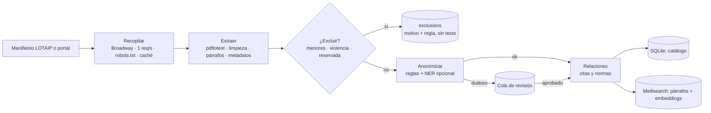

# Metodología

## Pipeline

Ningún modelo (NER, embeddings o generación) recibe texto antes del paso **Excluir**. La prueba T-01 lo verifica con dobles que registran todo lo que reciben.

## Fuente y fecha de corte

- Fuente preferida: corpus entregado por la Corte por solicitud LOTAIP ([borrador](solicitud-lotaip.md)).
- Alternativa: portal oficial, con `mix lexec.harvest --manifest <archivo>`: robots.txt por host (RFC 9309), máximo 1 petición por segundo (también en reintentos y redirecciones), `User-Agent` con contacto, caché por URL y por SHA-256, PDF borrado tras extraer el texto.
- La demo usa **16 sentencias ficticias publicables y 2 que deben excluirse** (`priv/seeds/corpus`).

## Exclusión (`priv/rules/exclusion.yaml`)

Orden: números de caso marcados por la Corte → banderas del manifiesto → tipos de acción excluidos → palabras clave (niñez, adolescencia, violencia intrafamiliar o de género, víctimas, información reservada). Criterio conservador: una coincidencia basta. Se guarda motivo, regla y versión, nunca texto.

## Anonimización (`priv/rules/anonymization.yaml`, `priv/rules/preserve.yaml`)

| Tipo | Método | Reemplazo |
|---|---|---|
| Correo | patrón | `[CORREO]` |
| Teléfono | patrón con contexto ("teléfono", "celular") o prefijo +593 | `[TELÉFONO]` |
| Cédula/RUC | toda corrida de 10 o 13 dígitos, con o sin separadores | `[CÉDULA]` |
| Dirección | texto tras "con domicilio en", "reside en"… hasta la coma | `[DIRECCIÓN]` |
| Persona | nombre tras palabras gatillo ("señora", "accionante", "periodista"…) o antes de "con cédula"; NER opcional | `[PERSONA n]`, estable dentro de la sentencia |

Se conservan instituciones y autoridades en ejercicio (lista + frases como "jueza ponente"). Si el NER entrega una persona con confianza menor a `ner_min_score`, la sentencia queda en `pending_review` y fuera del índice.

## Resultados medidos (2026-11-12)

| Prueba | Resultado |
|---|---|
| T-02 cédulas, teléfonos y correos (30 párrafos sintéticos + prueba por propiedades) | 0 filtrados |
| T-02 personas, solo reglas | ≥ 0,90 (umbral en YAML) |
| T-05 citas entre sentencias (100 casos anotados) | precisión y recall ≥ 0,95 |
| T-08 búsqueda (50 consultas con respuesta conocida) | solo palabras: MRR@10 0,731 · recall@5 0,76 — híbrida: MRR@10 0,949 · recall@5 0,98 |

## Límites conocidos

- Las reglas de nombres dependen de palabras gatillo; un nombre suelto sin contexto solo lo detecta el NER.
- La segmentación exige párrafos numerados; documentos sin numeración quedan rechazados (`:no_paragraphs`).
- Las métricas se midieron sobre datos sintéticos; con sentencias reales deben repetirse (`mix lexec.ner_eval`, `mix lexec.eval_search`).
