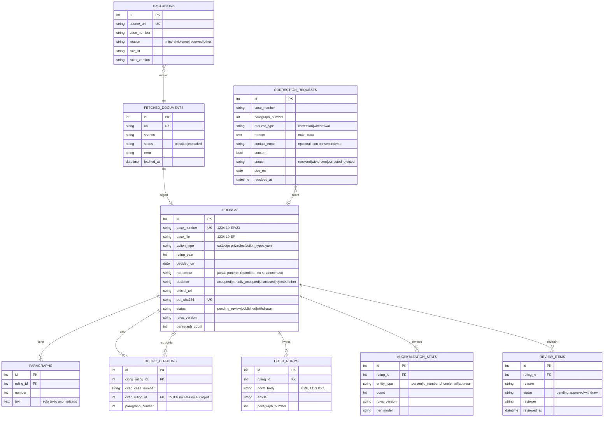

# Modelo de datos

Catálogo en SQLite (Ecto + `ecto_sqlite3`); el texto buscable vive además en Meilisearch (índice `paragraphs`).
Los nombres de tablas y campos están en inglés; la tabla de equivalencias con el documento base está al final.
Las migraciones están en `priv/repo/migrations/` (versionadas por fecha, como Flyway/Alembic).

## Tablas, restricciones y reglas

| Tabla | Campo | Tipo | Restricción | Regla / fuente (# en investigacion.md) |
|---|---|---|---|---|
| rulings | case_number | string | único, formato `^\d{1,5}-\d{2}-[A-Z]{2,3}/\d{2}$` o antiguo `^\d{3}-\d{2}-S[A-Z]{2,3}-CC$` | Numeración oficial (#4, S-6) |
| rulings | action_type | string | en catálogo `priv/rules/action_types.yaml` | Siglas oficiales (#4, S-3) |
| rulings | rapporteur | string | nulo permitido | Autoridad en ejercicio: no se anonimiza (#1 §7.2.2) |
| rulings | official_url | string | obligatorio, `https://` | Enlace al documento oficial en cada resultado (T-09) |
| rulings | pdf_sha256 | string(64) | único si no es nulo | No descargar ni indexar dos veces (T-07) |
| rulings | status | enum | `pending_review` no se indexa | Revisión humana antes de publicar (#1 §7.2.1 f) |
| paragraphs | (ruling_id, number) | int | único; `number ≥ 1` | Párrafos numerados de la sentencia (T-04) |
| paragraphs | text | text | ya anonimizado; nunca el original | Minimización (#1 §7.2.1 c, #6) |
| ruling_citations | (citing, cited_case_number, paragraph_number) | — | único | Red de precedentes (T-05) |
| cited_norms | norm_body | string | en catálogo `priv/rules/norms.yaml` | Normas citadas |
| exclusions | — | — | **sin campos de texto de la sentencia** | §7.2.9 c y §7.2.2 b (#1) |
| anonymization_stats | count | int | ≥ 0; **nunca el dato original** | Minimización (#6) |
| correction_requests | reason | text | 10–1000 caracteres | Canal de corrección y retiro (T-11) |
| correction_requests | contact_email | string | opcional; solo si `consent = true` | Consentimiento (#6) |
| correction_requests | due_on | date | `inserted_at + response_days` (`priv/rules/app.yaml`) | Plazo visible de respuesta |
| fetched_documents | url | string | único | Caché: nunca se descarga dos veces (T-07) |

Borrados: `paragraphs`, `ruling_citations`, `cited_norms`, `anonymization_stats` y `review_items` usan `ON DELETE CASCADE`.
`ruling_citations.cited_ruling_id` usa `ON DELETE SET NULL` (si se retira la citada, la cita textual al número de caso sigue siendo pública).

## Índice Meilisearch `paragraphs`

| Campo | Uso |
|---|---|
| `id` (`<ruling_id>-<number>`) | clave primaria |
| `text` | buscable |
| `case_number`, `action_type`, `ruling_year`, `rapporteur`, `decided_on`, `paragraph_number`, `official_url`, `ruling_id` | mostrados; `action_type`, `ruling_year`, `rapporteur`, `ruling_id` filtrables |
| `_vectors.e5` | embedding de 384 dimensiones calculado en Elixir (embedder `userProvided`) |

## Equivalencias con el documento base

| Documento base | Código |
|---|---|
| sentencia | `rulings` |
| parrafo | `paragraphs` |
| cita_sentencia | `ruling_citations` |
| norma_citada | `cited_norms` |
| exclusion | `exclusions` |
| anonimizacion | `anonymization_stats` |
| revision | `review_items` |
| correccion | `correction_requests` |
| (nuevo) caché de descargas | `fetched_documents` |

## Datos de ejemplo

`priv/seeds/corpus/*.txt` contiene sentencias **ficticias** escritas para este proyecto (personas, cédulas y números de caso inventados). Ninguna es una sentencia real de la Corte.
